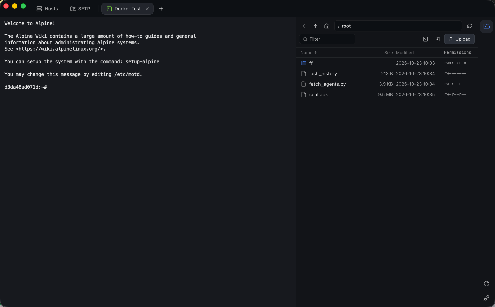
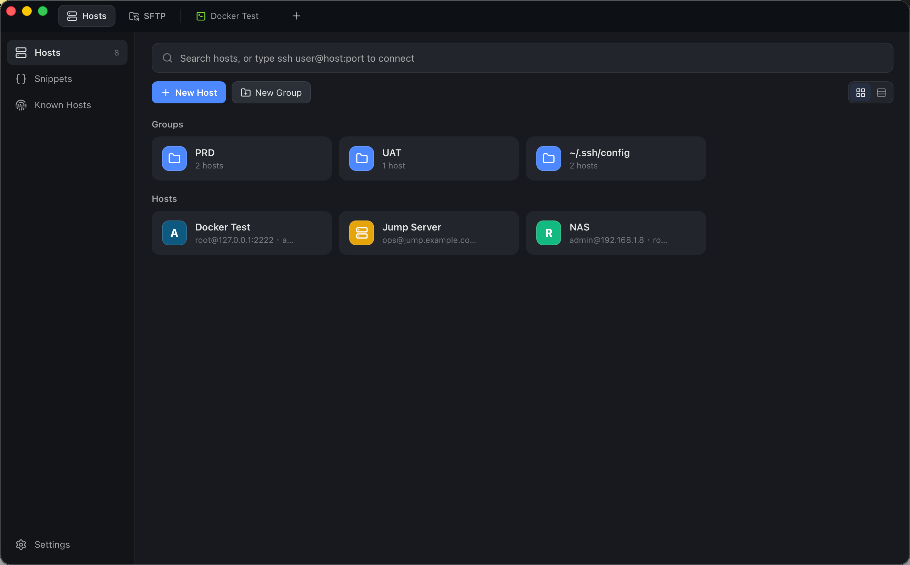
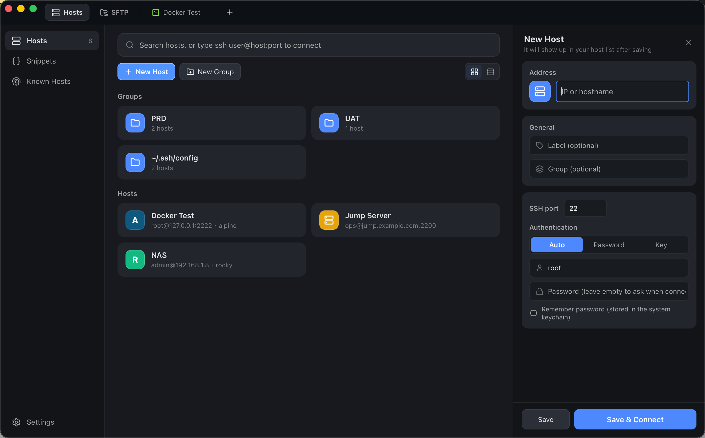
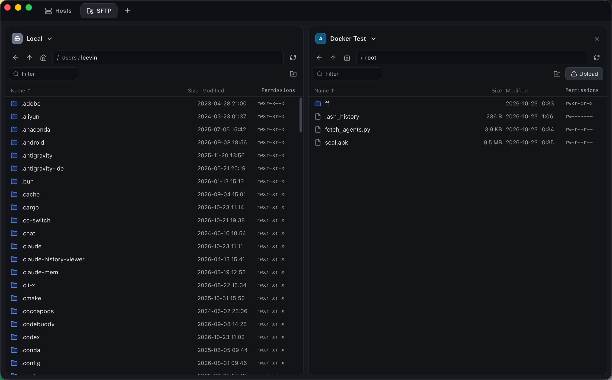

<div align="center">

# ShellTree

**免费、开源、轻量的 SSH / SFTP 桌面客户端，支持 macOS 和 Windows。**

基于 Rust 和 Tauri 构建。终端、文件传输、主机管理放在一个窗口里，打开快、占用少、传输快。

[](LICENSE)


[English](README.md) · 简体中文

[**下载**](https://github.com/ADroidCoder/ShellTree/releases/latest) · [功能](#功能) · [性能](#性能) · [从源码构建](#从源码构建)

</div>

<p align="center"></p>

---

## 为什么做 ShellTree

常用的 SSH 客户端要么收费、要注册账号，要么基于 Electron 或 Java，装好就是几百 MB，开几个会话内存就上去了。ShellTree 想做的是一个**打开就能用、不卡、不收费**的工具：

- **轻量**：使用系统自带的 WebView，不打包浏览器内核，安装包只有几 MB。
- **快**：SSH 协议用纯 Rust 实现（[russh](https://github.com/Eugeny/russh)），终端用 GPU 渲染；SFTP 读写时同时发出多个请求，传文件夹时多个文件并行。
- **和命令行一致**：读取 `~/.ssh/config` 里的主机，主机指纹记录在 `~/.ssh/known_hosts`，支持 ssh-agent，和系统的 `ssh` 命令共用同一套配置。
- **免费开源**：Apache 2.0 协议，不需要注册账号，没有数据收集，密码只存在系统钥匙串里。

## 下载

在 [**Releases 页面**](https://github.com/ADroidCoder/ShellTree/releases/latest) 下载最新安装包。还没有发布安装包时，可以先[从源码构建](#从源码构建)。

| 平台 | 文件 |
|---|---|
| macOS（Apple 芯片） | `ShellTree_<版本>_aarch64.dmg` |
| macOS（Intel） | `ShellTree_<版本>_x64.dmg` |
| Windows 10 / 11（x64） | `ShellTree_<版本>_x64-setup.exe` 或 `ShellTree_<版本>_x64_en-US.msi` |

> [!NOTE]
> 安装包暂时没有代码签名。
> - **macOS**：如果提示“已损坏”或“无法打开”，在终端运行一次 `xattr -cr /Applications/ShellTree.app`，或者右键点应用选择“打开”。
> - **Windows**：如果出现 SmartScreen 提示，点“更多信息 → 仍要运行”。

## 功能

<p align="center">
  
  
</p>

### 主机管理
- **分组和卡片**：主机按分组显示，可以切换成卡片或列表；支持新建空分组、重命名、解散分组，右键把主机移到别的分组。
- **快速连接**：在搜索框里直接输入 `root@10.0.0.1:22` 回车就能连，不用先保存。
- **自动读取 `~/.ssh/config`**：配置文件里的主机自动出现在列表里，可以一键保存为主机。
- **识别服务器系统**：第一次连接时自动识别 Ubuntu、Debian、CentOS、Alpine 等，主机图标按系统显示颜色。
- **认证方式**：自动（和 `ssh` 一样，先试 ssh-agent 和 `~/.ssh` 里的默认密钥，不行再用密码）、密码、私钥（支持带密码的私钥）。密码保存在系统钥匙串（macOS 钥匙串 / Windows 凭据管理器）。
- **跳板机**：先登录跳板机，再通过它连接内网主机（和 `ssh -J` 一样），可以多层；`~/.ssh/config` 里的 `ProxyJump` 也能识别。
- **验证码登录**：服务器要求输入动态验证码（Google Authenticator 等）时弹窗输入，密码 + 验证码、私钥 + 验证码都支持。
- **主机指纹校验**：第一次连接时显示指纹让你确认；指纹变化时醒目警告，防止中间人攻击。
- **已知主机**：查看和删除 `~/.ssh/known_hosts` 里的记录，服务器重装后删掉旧指纹就能重新连接；右键可以把记录添加为主机。

### 终端
- **xterm.js + WebGL 渲染**：256 色和真彩色，中文和 emoji 宽度正确，大量输出时也流畅。
- **刷屏不卡**：`cat` 大文件或 `yes` 刷屏时，后端按界面的处理速度发送输出，界面始终能响应，Ctrl+C 立即生效。
- **历史命令灰色提示**：输入命令的开头时，根据这台主机执行过的命令用灰色字提示补全，按 → 或 End 接受（和 fish、zsh-autosuggestions 一样）。输密码时不会被记录，在 vim、top 这类全屏程序里不提示；历史只保存在本机，可以随时清除。
- **命令片段**：保存常用命令，在终端右侧的片段面板里一键插入或执行；命令里可以写 `{{变量}}`，执行前弹窗填写。
- **多会话标签页**：每个会话一个标签页，标签上的颜色表示连接状态。
- **断线自动重连**：网络断开后自动重连，之前的输出保留在屏幕上；也可以按回车立即重连。
- **端口转发**：本地转发（`-L`，例如把服务器上的数据库映射到本机）、远程转发（`-R`）、SOCKS5 动态转发（`-D`）。在主机设置里配置后每次连接自动开启，也可以在终端右侧面板临时添加；`~/.ssh/config` 里的 `LocalForward` 等也能识别。
- 右键菜单复制、粘贴、清屏；Windows 上复制粘贴用 Ctrl+Shift+C / V，Ctrl+C 留给终端。
- 按住 ⌘ / Ctrl 点击链接，在浏览器里打开。

### SFTP
<p align="center"></p>

- **终端旁边的文件面板**：和终端共用同一条连接，不用再登录一次；可以在终端里 `cd` 到某个文件夹（“在终端中打开”）。
- **SFTP 双栏**：左右两栏分别选本地或任意主机，在两栏之间拖动文件就是上传或下载。
- **拖拽上传**：从访达 / 资源管理器把文件或文件夹拖进来；拖到某个文件夹上就传进那个文件夹。
- **传输队列**：显示进度、速度、剩余时间，可以取消；失败或取消时清理传了一半的文件；下载时本地有同名文件会自动改名，不会覆盖。
- **直接编辑远程文件**：双击文本文件，用本机的编辑器（默认是系统文本编辑器，可以在设置里换成 VS Code 等）打开，保存后自动传回服务器；服务器上的文件在这期间被别人改过时会提醒。
- 重命名、删除、新建文件夹、修改权限、复制路径；文件列表虚拟滚动，几万个文件的目录也不卡。
- 上传脚本时保留可执行权限。

### 应用
- **深色 / 浅色 / 跟随系统**三种外观。
- **中英文界面**：默认跟随系统语言，可以在设置里随时切换，不用重启，已打开的会话不会断开。
- 终端字号可调。
- **自动更新**：后台检查 GitHub Release，有新版本时右上角提示，一键安装并重启。更新包带签名，安装前会校验。

## 快捷键

Windows 上把 ⌘ 换成 Ctrl+Shift（Ctrl+字母要留给终端，比如 Ctrl+W 删除单词）。

| 快捷键 | 作用 |
|---|---|
| ⌘T | 新建连接（打开主机搜索） |
| ⌘N | 新建主机 |
| ⌘W | 关闭当前会话 |
| ⌘1 ~ ⌘9 | 切换到第 N 个会话 |
| ⌘E | 显示 / 隐藏文件面板 |
| ⌘J | 显示 / 隐藏命令片段 |
| → / End | 接受灰色的命令提示 |
| ⌘C / ⌘V | 终端复制 / 粘贴（Windows：Ctrl+Shift+C / V） |
| ⌘K | 清屏 |

## 性能

在本机用 Docker 里的 OpenSSH 服务器（回环网络）实测：

| 场景 | 结果 |
|---|---|
| 连接并登录 | ~50 ms |
| 上传 200 MB 文件 | ~89 MB/s |
| 下载 200 MB 文件 | ~53 MB/s |
| 上传 501 个小文件的文件夹 | 0.46 s |

实现方式：

- **SFTP 流水线**：读写文件时同时发出最多 64 个请求，不用等每个请求回复，高延迟的线路上也能跑满带宽。
- **小文件并行**：传整个文件夹时 4 个文件同时传，避免每个文件打开、关闭的往返时间叠加。
- **终端输出合并 + 流控**：输出以二进制传给界面（不转 JSON），界面处理完一批再发下一批，这段时间到达的输出合并成一大块。
- **一条连接多个通道**：终端和 SFTP 共用同一条 SSH 连接，打开文件面板不用重新握手和登录。

自己测（需要一台测试用的 SSH 服务器）：

```bash
cargo run --release -p shelltree-core --example smoke -- 主机 端口 用户名 密码
```

## 从源码构建

**环境要求**

- [Rust](https://rustup.rs/) 1.85 或更新
- [Node.js](https://nodejs.org/) 22 或更新
- 仅 Windows：[WebView2](https://developer.microsoft.com/microsoft-edge/webview2/)（Windows 10/11 一般自带）和 Visual Studio C++ 生成工具

```bash
git clone https://github.com/ADroidCoder/ShellTree.git
cd ShellTree
npm install

npm run tauri dev     # 开发模式运行
npm run tauri build   # 打包安装包
```

产物位置：

- macOS：`target/release/bundle/dmg/*.dmg` 和 `target/release/bundle/macos/*.app`
- Windows：`target/release/bundle/msi/*.msi` 和 `target/release/bundle/nsis/*.exe`

**测试**

```bash
cargo test -p shelltree-core   # 核心库测试
npm test                     # 命令行识别（灰色提示）的测试
cargo run -p shelltree-core --example otp   # 验证码登录（在本机起一个测试服务器）
npm run check                # 前端类型检查
```

**发布新版本**由 [GitHub Actions](.github/workflows/build.yml) 完成：

1. 把 `src-tauri/tauri.conf.json`、`src-tauri/Cargo.toml`、`package.json` 里的版本号改成新版本（三处必须一致，CI 会检查）。
2. 提交后推送标签：`git tag v0.2.0 && git push origin v0.2.0`。
3. CI 打出 Windows 和两种 Mac 的安装包，发布 Release，并附上 `latest.json`，已安装的用户会收到更新提示。

第一次发版前，在仓库 Settings → Secrets and variables → Actions 里添加自动更新的签名私钥：`TAURI_SIGNING_PRIVATE_KEY`（私钥文件的内容）和 `TAURI_SIGNING_PRIVATE_KEY_PASSWORD`（私钥密码）。私钥一旦丢失，已经安装的版本就再也收不到更新，请务必备份。

平时推送代码只跑测试；在 Actions 页面手动运行可以只打包不发布，安装包在这次运行的 Artifacts 里下载。

## 目录结构

```
crates/shelltree-core/   核心库（不依赖界面，可以单独测试）
  src/conn.rs          建立连接、主机指纹校验、登录（密码 / 私钥 / ssh-agent）
  src/shell.rs         终端通道、输出合并和流控
  src/forward.rs       端口转发（本地 / 远程 / SOCKS5）
  src/sftp.rs          远程文件操作、上传下载
  src/local.rs         本地文件操作（SFTP 双栏的本地一栏）
  src/hosts.rs         主机列表、~/.ssh/config 读取、钥匙串
  src/known_hosts.rs   ~/.ssh/known_hosts 查看和删除
  examples/smoke.rs    对着真实服务器的端到端测试
src-tauri/             Tauri 桌面程序，把核心库暴露给界面
src/                   Svelte 5 界面
  lib/cmdline.ts       识别终端里正在输入的命令（灰色提示用）
tests/                 前端测试
```

**技术栈：** Rust · [russh](https://github.com/Eugeny/russh) · [russh-sftp](https://github.com/AspectUnk/russh-sftp) · [Tauri 2](https://tauri.app/) · [Svelte 5](https://svelte.dev/) · [xterm.js](https://xtermjs.org/) · TypeScript

## 参与贡献

欢迎提 Issue 和 Pull Request。提交 PR 前请确认 `cargo test -p shelltree-core`、`npm test` 和 `npm run check` 都能通过。

## 开源协议

本项目基于 [Apache License 2.0](LICENSE) 开源：可以免费用于个人和商业用途，可以修改和再发布；再发布时需要保留版权和协议声明，并注明修改过的地方。
